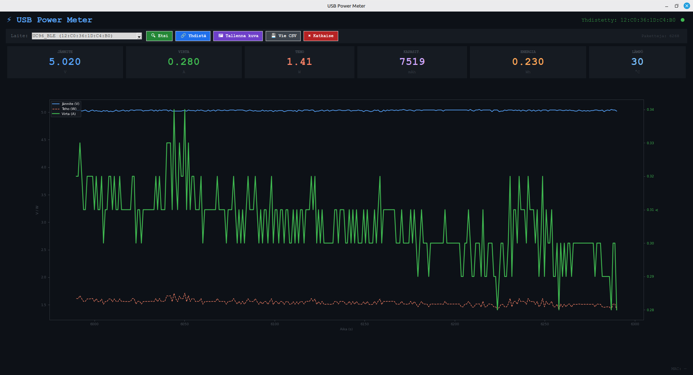
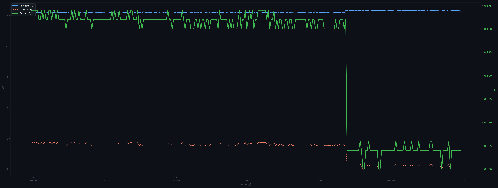

# ⚡ USB Power Meter

Graphical BLE-based USB power meter in Python. Connects wirelessly to
J7-C / UC96 type USB testing modules and displays measurement data
in real time with a live chart and numeric readouts.



---

## Background — Why This Was Built

The project originated during fault diagnosis of a MacBook Air (A2337, M1).
The MacBook would not charge or boot. Logic board voltages and NAND resistances
were correct, narrowing the fault to USB-C PD negotiation.

A USB tester made it possible to measure exactly what happens when the charger
is connected: on the faulty MacBook, current rose to 0.16 A and dropped back to
0.08 A — the device entered DFU mode but the 20 V PD negotiation failed and it
would not boot. On a working unit the negotiation succeeds and current rises to 2–3 A.

The meter is also well suited to analysing the charging behaviour of other devices:
monitoring charging current and voltage for iPhones, Android phones, laptops, and
power banks, as well as checking the condition of cables and chargers.

---

## What USB-C PD Negotiation Means

When a USB-C cable is connected, the charger and device negotiate a suitable
voltage and current over the CC lines (Configuration Channel). Before negotiation
current always flows at 5 V — if negotiation fails, the connection stays at 5 V
even if the charger supports 100 W.

**Fault diagnosis interpretation:**

| Measurement | Meaning |
|---|---|
| Voltage stays at 5 V | PD negotiation failed |
| Current below 1 A | Negotiation failed or cable does not support PD |
| Current 2–3 A, voltage 20 V | PD contract succeeded (normal MacBook charging) |
| Current 0.08–0.16 A, voltage 5 V | MacBook in DFU mode, not booting |

---

## Features

- **BLE scanning** — automatically discovers nearby devices, no need to hard-code a MAC address
- **Real-time chart** — voltage, current, and power update at 2×/s with a scrolling view
- **6 readouts** — VOLTAGE (V), CURRENT (A), POWER (W), CAPACITY (mAh), ENERGY (Wh), TEMPERATURE (°C)
- **CSV recording** — saves data in real time during measurement; file path selected via dialog
- **CSV export** — exports in-memory data to file at any point
- **Dark-themed GUI** — tkinter + matplotlib with TkAgg backend

---

## Requirements

```bash
pip install bleak matplotlib
```

`tkinter` is included with Python. Tested on Python 3.12 / Linux.

> **Note on Linux:** Cheap USB Bluetooth dongles (e.g. Hama 00049218,
> Cambridge Silicon Radio HCI-mode) do not work — they do not support Classic
> Bluetooth (BR/EDR/SPP). Use an Asus BT500, TP-Link UB500, or the computer's
> built-in Bluetooth.
>
> Check whether the device is visible: `sudo hcitool scan` → should show `UC96_SPP`

---

## Usage

```bash
# Recommended: virtual environment
python3 -m venv venv
source venv/bin/activate
pip install bleak matplotlib

python3 USBPowerMeterGUI.py
```

### Workflow

1. **🔍 Scan** — scans for BLE devices (5 s), populates the drop-down menu
2. **Select device** from the drop-down
3. **🔗 Connect** — establishes the BLE connection; status shown in the top-right corner
4. **🖼 Save image** — saves the current chart as a PNG file (200 dpi)
5. **💾 Export CSV** — exports in-memory data (last 300 points) to file
6. **✖ Disconnect** — closes the BLE connection

---

## Supported Devices

Tested:

| Device | BLE Service UUID |
|---|---|
| UC96 BLE / J7-C | `0000ffe0-0000-1000-8000-00805f9b34fb` |

Search term on AliExpress: *USB Tester Type-C PD Digital Capacity Meter 8A
Voltage Current Monitor Power Bank Charger Detector with QC3.0 Fast Charging*.
Price including shipping approximately €14. Works bidirectionally — input and
output can be connected in reverse.



---

## Packet Format (36 bytes)

```
Offset  0– 1: FF 55        → header (fixed)
Offset  2   : message type
Offset  3   : device/subtype
Offset  4– 6: voltage      big-endian / 100 → V
Offset  7– 9: current      big-endian / 100 → A
Offset 10–12: capacity     big-endian       → mAh
Offset 13–15: energy       big-endian / 100 → Wh
Offset 17–18: D+ voltage   big-endian / 100 → V  (fast-charge protocol detection)
Offset 19–20: D- voltage   big-endian / 100 → V
Offset 21–22: temperature  big-endian       → °C
Offset 35   : checksum     (XOR or sum mod 256)
```

> Xiaomi Turbo Charge does not use the PD protocol — it relies on a USB-A to USB-C
> cable with a special eMarker pin. VBUS readings may appear incorrect with
> non-standard charging protocols.

---

## CSV Format

```
timestamp,voltage,current,power,mah,wh,temp
1742379600.123,4.770,0.910,4.34,6131,0.200,27
```


---

## File Structure

```
USBMeter/
├── USBPowerMeterGUI.py   # Main program — GUI + BLE + live chart
├── USBPowerMeter.py      # Original CLI version (without GUI)
├── README.md
└── samples/              # Example images and CSV files
```

---

## License

MIT License


Permission is hereby granted, free of charge, to any person obtaining a copy
of this software and associated documentation files (the "Software"), to deal
in the Software without restriction, including without limitation the rights
to use, copy, modify, merge, publish, distribute, sublicense, and/or sell
copies of the Software, and to permit persons to whom the Software is
furnished to do so, subject to the following conditions:

The above copyright notice and this permission notice shall be included in all
copies or substantial portions of the Software.

THE SOFTWARE IS PROVIDED "AS IS", WITHOUT WARRANTY OF ANY KIND, EXPRESS OR
IMPLIED, INCLUDING BUT NOT LIMITED TO THE WARRANTIES OF MERCHANTABILITY,
FITNESS FOR A PARTICULAR PURPOSE AND NONINFRINGEMENT. IN NO EVENT SHALL THE
AUTHORS OR COPYRIGHT HOLDERS BE LIABLE FOR ANY CLAIM, DAMAGES OR OTHER
LIABILITY, WHETHER IN AN ACTION OF CONTRACT, TORT OR OTHERWISE, ARISING FROM,
OUT OF OR IN CONNECTION WITH THE SOFTWARE OR THE USE OR OTHER DEALINGS IN THE
SOFTWARE.

---

*Further reading on MacBook Air M1 fault diagnosis and PD negotiation theory:*
*[Using a USB Digital Tester for MacBook Fault Diagnosis](macbook-diagnosis.md)* and
*[MacBook Air M1 A2337 Fault Diagnosis](macbook-air-m1-a2337-diagnosis.md)*
