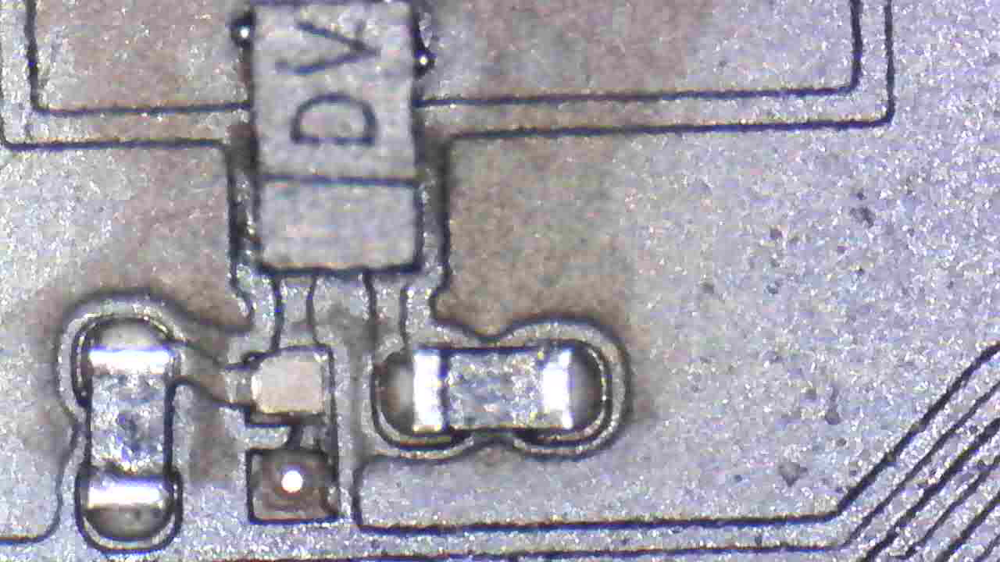
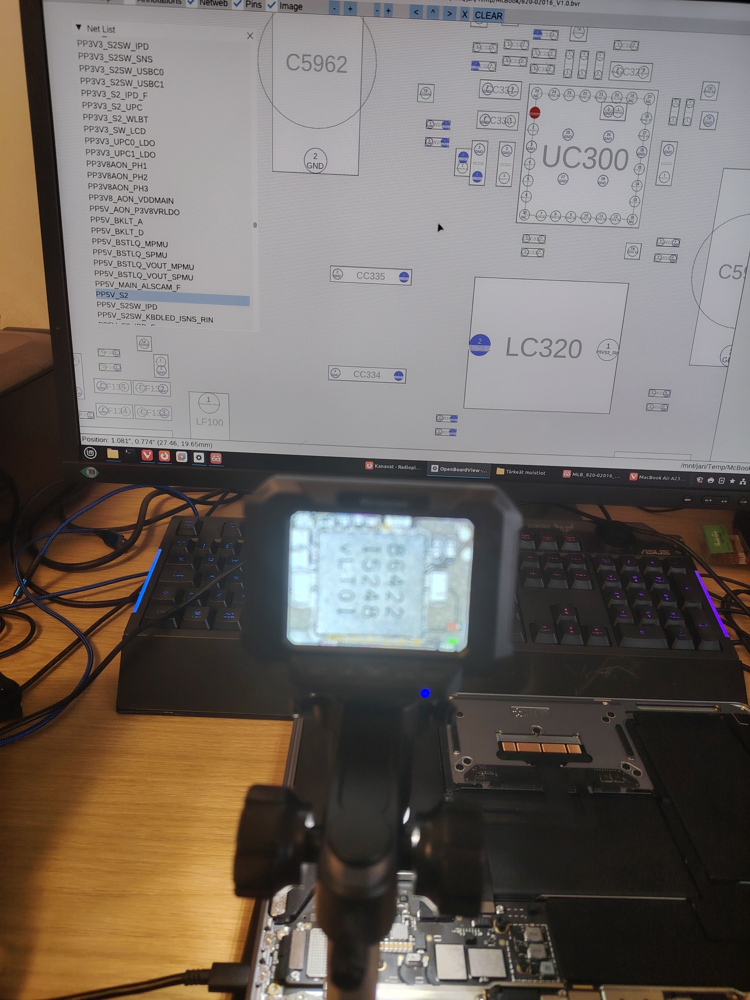
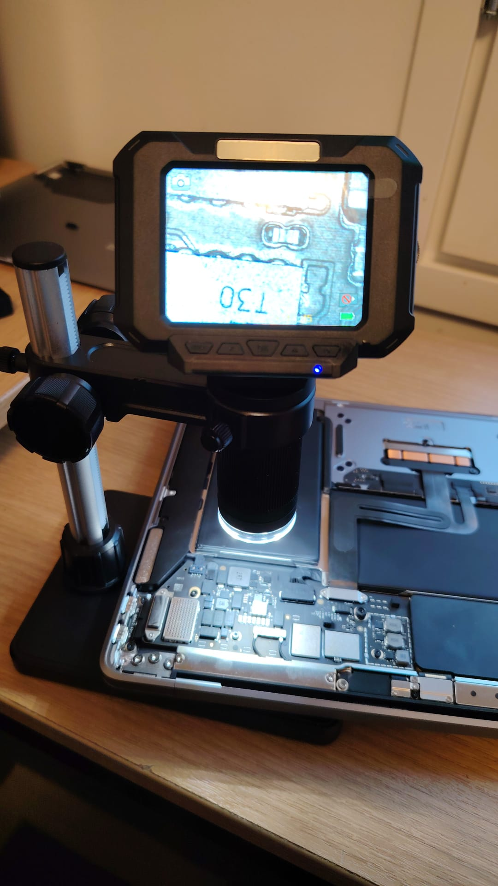
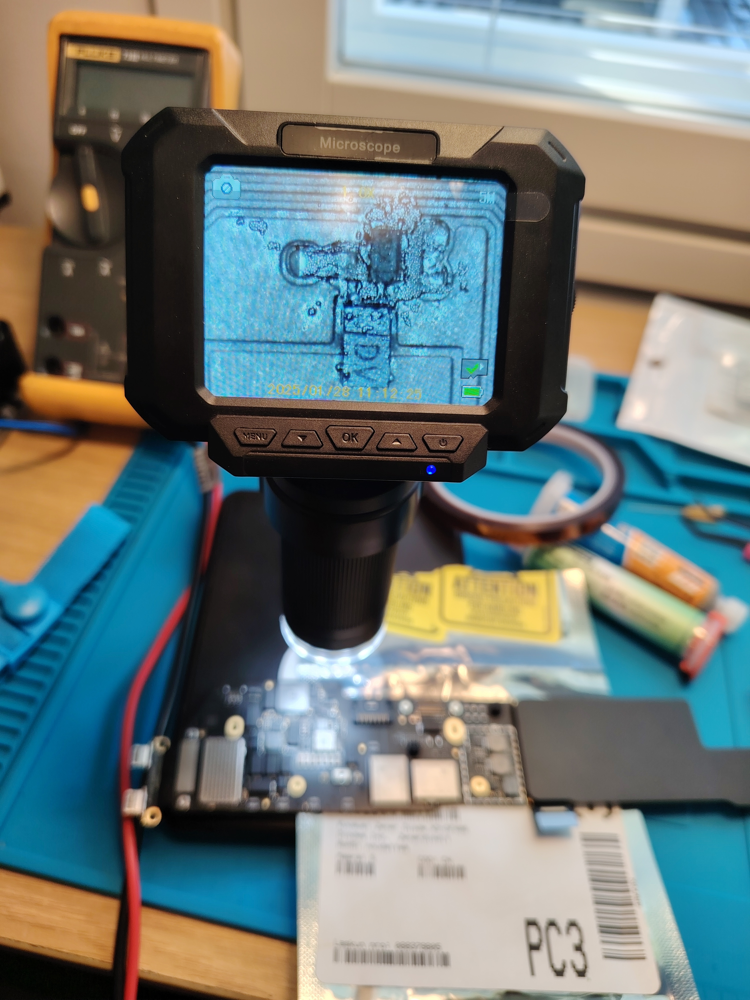

# MacBook Air M1 (A2337) – ei lataa eikä käynnisty, mitä sitten?

Pojaltani oli hajonnut viisi vuotta vanha MacBook Air M1 ja ajattelin oppiakseni yrittää korjata sitä. Korjaamalla vanhan laitteen säästää myös luonnon varoja. Foorumeilla tosin kerrotaan, että MacBookit on suunniteltu kestämään 4-5 vuotta ja niitä ei voi korjata. 

## Alkutilanne

MacBook ei lähde käyntiin eikä lataa. Mikään osa ei vaikuta lämpiävän. MacBookissa on käytetty torxeja koot 4 ja 5 sekä perhosen muotoista Pentalobe ruuveja (1.2). Alla olevassa kuvassa pentalobe ruuvit ovat kirkkaita, porttiliittimien päällä olevia ruuveja (pellin palat pitämässä liitintä kiinni kuten vasemmalla USB-portin lattakaapeli). [Avausohjeet](https://www.ifixit.com/Guide/MacBook+Air+13-Inch+Late+2020+Logic+Board+Replacement/142562).

Logic board on tyypiltään **820-02016 **ja sille onneksi [löytyy schemat ja kuvat OpenBoardViewerille](https://repair.wiki/w/MacBook_Air_A2337). 

### Jännitteet piirilevyltä mitattuna

LOGIC BOARD DETACHED (NO CONNECTORS EXCEPT USB BOARD):

- PPBUS_AON: 11.96V (C5804)
- PP3V8_AON_VDDMAIN: 3.79V (C5895)
- PP5V_S2: 5.18V (CP717)
- PP3V3_S2_UPC: 3.29V(CF751)
- PP3V3_UPC0_LDO: 3.27V (RF242)
- PP3V3_UPC1_LDO: 3.29V (CF508)
- PP1V5_UPC0_LDO_CORE: 1.59V (CF405)
- PP1V5_UPC1_LDO_CORE: 1.585V (CF505)
- PP1V8_AON: 1.801V (CR851)

LOGIC BOARD IN PLACE AND ALL CONNECTORS:

- PP1V8_S2: 1.796V (JR850)
- PP1V25_S2: 1.223V (JF202 PIN 12)

## Firmiksen palautusyritys

Joskus MacBook voi jäädä boottilooppiin firmiksen sekoamisen vuoksi. Applen omalla Apple Configurator 2:lla ja toisella Mac:lla firmiksen palautus ei tähän laitteeseen onnistu. Softa ei kuitenkaan kerro paljoa syytä miksi ei onnistu. Firmiksen päivitys onnistuu myös mm. Linuxilla käyttämällä [idevicerestorea](https://github.com/libimobiledevice/idevicerestore) (Github linkki) ja logista näkee enemmän syitä miksi palautus ei onnistu. Restore löytää emolevyn (DFU moden), mutta ei pysty käynnistämään palautusta:

- Command: idevicerestore -e UniversalMac_26.2_25C56_Restore.ipsw
- Found device in DFU mode
- ECID: 7055480287406366
- Identified device as j313ap, MacBookAir10,1
- Device Product Version: N/A
- Device Product Build: N/A
- Extracting BuildManifest from IPSW
- IPSW Product Version: 26.2
- IPSW Product Build: 25C56 Major: 25
- Device supports Image4: true
- Variant: Customer Erase Install (IPSW)
- This restore will erase all device data.
- Performing macOS restore
- ##################################[ WARNING ]#################################
- # You are about to perform an *ERASE* restore. ALL DATA on the target device #
- # will be IRREVERSIBLY DESTROYED. If you want to update your device without #
- # erasing the user data, cancel now and restart without -e or --erase #
- # command line switch. #
- # Type YES and press ENTER to continue, or hit CTRL+C to cancel. #
- ##############################################################################
- > YES
- Checking IPSW for required components...
- All required components found in IPSW
- Getting ApNonce in DFU mode... 7e a0 3f 15 bd 03 bd 5b 79 cd c6 21 7b 76 39 d7 fa f4 e8 88 a3 ac 0a 19 12 c6 b7 d3 be cb 61 56
- Trying to fetch new SHSH blob
- Getting SepNonce in dfu mode... b2 86 47 9d fc b7 b7 96 ab 7f 80 9f a7 a3 60 eb 2a e3 ec 75
- Received SHSH blobs
- Getting SepNonce in dfu mode... b2 86 47 9d fc b7 b7 96 ab 7f 80 9f a7 a3 60 eb 2a e3 ec 75
- Received SHSH blobs
- Getting SepNonce in dfu mode... b2 86 47 9d fc b7 b7 96 ab 7f 80 9f a7 a3 60 eb 2a e3 ec 75
- Received SHSH blobs
- Extracting [iBSS.j313.RELEASE.im](http://iBSS.j313.RELEASE.im)4p (Firmware/dfu/[iBSS.j313.RELEASE.im](http://iBSS.j313.RELEASE.im)4p)...
- Personalizing IMG4 component iBSS...
- Sending iBSS (770863 bytes)...
- Uploading [==================================================] 100.0%
- Device did not reconnect in DFU or recovery mode. Possibly invalid iBSS. Reset device and try again.
- Unable to place device into recovery mode from DFU mode

## Emolevyn jännitteitä mitatessa...

Jännitteitä mitatessani havaitsin piirilevyltä puuttuvan D5270 diodin. Kytkentäkaavion mukaan diodi liittynee enemmänkin akun lataukseen, mutta koska mielestäni sen kuuluisi olla paikallaan, tilasin diodin varmuuden vuoksi.

Diodi OnboardViewerissä:

Didodin koko on 0,3 x 0,6 mm eli 0201 pintaliitoskomponentti. [Mouser Electronicissa](https://www.mouser.com/) diodi Zener Diode X3-DFN06 X3-DFN0603-2 maksaa 0,103€ ja niitä kannattaa tilata samalla useampi, sillä diodin juottamisessa niitä voi lipsahtaa pinseteistä ja hävitä.

Diodi on niin pieni, ettei sitä meinaa silmillä nähdä. Tarvitset mikroskoopin tai hyvän suurennuslasin.

Tilasin myös USB jännitemittarin, malliltaan J7-c ja bluetoothilla varustettuna. Yllätyksenä USB Bluetooth-donglet eivät välttämättä tunnista vanhoja bluetooth-modeja, joten jouduin hankkimaan myös ASUS USB-BT500 donglen Linuxi PC:lle. Läppärin bluetoothissa oli vanhat modet, mutta en tykkää koodata pienellä näytöllä.

Tein USB mittaria varten sovelluksen, joka etsii bluetooth-laitteen UC96_BLE ja loggaa mitatut jännitteet, virran ja tehon CSV-tiedostoon ja tekee siitä graafin matplotlibin avulla. Kun MacBook yrittää käynnistyä, pysyy jännite 5V ja ajoittain näkyy noin 0.18 ampeerin virtapiikkejä. Missään vaiheessa ei näy 20 volttia. Koodin löydät [Codebergistä](https://codeberg.org/hiltsu/USB-Power-Meter).

Aluksi vaikutti siltä, että vika olisi SSD/NAND-piireissä (ja foorumeilla usein toistuvana vikana), mutta yleismittarilla mitattuna NAND-AWAKE-linjat vaikuttaisivat olevan tyypillisillä tasoilla:

- PP0V88_AWAKE_NAND: 216.0 (FLN001)
- PP1V25_AWAKE_NAND: 215.5 (CN03A)
- PP2V5_AWAKE_NAND: 588 kOhm (RN522, vaihtelee)

Vaikuttaa siis siltä, että PD (Power Delivery) neuvottelu laturin kanssa ei onnistu. Ilmeisesti MacBook Air ei osaa pyytää tarvittavaa 20 voltin jännitettä virtalähteeltä. Kaapeleita ja eri latureita on kokeiltu, eli vika ei ole niissä.

## Diodin juottaminen paikoilleen

Diodin juottaminen vaatii hyvän mikroskoopin, sopivaa juotospastaa, kuumailmapuhaltimen ja todella rautaiset hermot. Aluksi juotospinnat kannattaa puhdistaa, sitten levittää juotospastaa. Juotospastan valinta on myös tärkeä.

Ympäröiviä komponentteja voi yrittää suojata Kapton-teipillä, mutta sekään ei kestä pitkään yli 300 asteen puhalluslämpötilaa.

Juotospasta Sn63Pb37 sopii 0201-kokoisten komponenttien juottamiseen. Se sisältää Sn63Pb37-sulametallia + flux IPX3, hiukkaskoko tyyppiä 3 (25–45 µm). Pastan sulamispiste on matala ~183 °C → vähemmän lämpörasitusta komponentille ja piirilevylle verrattuna lyijyttömään.

Juotospasta pitää diodia kiinni, mutta diodin asettaminen paikoilleen voi olla hermoja raastavaa, sillä alle 1 mm piikit tuppaavat olemaan liian isot. Pinseteistä diodi lähtee lentoon ja häviää osaksi huoneen pölyjä. Lisäksi tulee muistaa se, että diodin viiva on katodi ja sen tulee osoittaa fettiin Q5270 päin.

Kuumailma-asemalla pidin lämpötilana 340–350 °C ja matalimman mahdollisen ilmavirran. Esilämmitin levyä ensin ~150–200 °C ja sitten kuumensin diodia noin minuutin. Ongelma on se, että vaikka puhaltimessa on pienin reikä, puhallus tahtoo kuumentää väkisin muitakin komponentteja vierellä. Onneksi tämä diodi on piirilevyn reunalla, joskin aluksi poltin mikroskooppialustan muovia kun osa ilmavirrasta meni ohi. Siksi näet purkinavaajan (metallia) suojaamassa mikroskoopin alustaa.

Juottamisen jälkeen tulee tarkistaa yleismittarilla asennus. Käytännössä etsi onko tullut oikosulkuja ja onko diodin kontaktit varmasti kunnossa.

## Tilanne diodin vaihdon jälkeen

Diodin juottamisen jälkeen tilanne muuttui.

MacBook neuvotteli nyt virtalähteen kanssa oikein 20V jännitteen. Virrankulutus pysyy kuitenkin pienenä, eli edes akkua ei ladata.

Palautus menee nyt myös pidemmälle, mutta ei silti onnistu:DFU tila on myös muuttunut:

- sudo idevicerestore UniversalMac_26.2_25C56_Restore.ipsw 
- idevicerestore 1.0.0-268-g74e3bd9 (libirecovery 1.3.1, libtatsu 1.0.5-3-g60a39f3)
- Found device in DFU mode
- ECID: 7055480287406366
- Identified device as j313ap, MacBookAir10,1
- Device Product Version: N/A
- Device Product Build: N/A
- Extracting BuildManifest from IPSW
- IPSW Product Version: 26.2
- IPSW Product Build: 25C56 Major: 25
- Device supports Image4: true
- Variant: Customer Upgrade Install (IPSW)
- This restore will update the device without erasing user data.
- Performing macOS restore
- Checking IPSW for required components...
- All required components found in IPSW
- Getting ApNonce in DFU mode... 52 d9 34 47 c0 b9 16 df 7d b1 8c 24 56 8a 9c e7 6a 57 ed a5 89 10 d5 26 0b 84 60 6b 61 d5 24 a0
- Trying to fetch new SHSH blob
- Getting SepNonce in dfu mode... dc 30 9a e3 f8 e9 99 16 0b c1 43 24 2a 62 11 54 05 36 30 29
- Received SHSH blobs
- Getting SepNonce in dfu mode... dc 30 9a e3 f8 e9 99 16 0b c1 43 24 2a 62 11 54 05 36 30 29
- Received SHSH blobs
- Getting SepNonce in dfu mode... dc 30 9a e3 f8 e9 99 16 0b c1 43 24 2a 62 11 54 05 36 30 29
- Received SHSH blobs
- Extracting [iBSS.j313.RELEASE.im](http://iBSS.j313.RELEASE.im)4p (Firmware/dfu/[iBSS.j313.RELEASE.im](http://iBSS.j313.RELEASE.im)4p)...
- Personalizing IMG4 component iBSS...
- Sending iBSS (770863 bytes)...
- Uploading [==================================================] 100.0% 
- Nonce: 3b 0b 28 af 29 92 d5 49 07 b1 77 7f 30 fb df aa 21 3c ca fa 77 9e df 9a 7e 47 98 18 20 db b0 26
- Trying to fetch new SHSH blob
- Getting SepNonce in dfu mode... fe 5a 2b ca ee 21 e5 6b 50 0e ac 13 e7 b6 e6 08 96 05 e2 37
- Received SHSH blobs
- Personalizing IMG4 component Ap,LocalPolicy...
- Sending Ap,LocalPolicy (3041 bytes)...
- Uploading [==================================================] 100.0% 
- INFO: executing command: lpolrestore
- Extracting [t8103ciofw.im](http://t8103ciofw.im)4p (Firmware/[t8103ciofw.im](http://t8103ciofw.im)4p)...
- Personalizing IMG4 component Ap,RestoreCIO...
- Sending Ap,RestoreCIO (179054 bytes)...
- Uploading [                                                  ]   0.0% Unable to send Ap,RestoreCIO component: Unable to upload data to device
- Unable to send Ap,RestoreCIO to device.
- Unable to send component 'Ap,RestoreCIO' to device.sudo idevicerestore UniversalMac_26.2_25C56_Restore.ipsw 
- idevicerestore 1.0.0-268-g74e3bd9 (libirecovery 1.3.1, libtatsu 1.0.5-3-g60a39f3)
- Found device in DFU mode
- ECID: 7055480287406366
- Identified device as j313ap, MacBookAir10,1
- Device Product Version: N/A
- Device Product Build: N/A
- Extracting BuildManifest from IPSW
- IPSW Product Version: 26.2
- IPSW Product Build: 25C56 Major: 25
- Device supports Image4: true
- Variant: Customer Upgrade Install (IPSW)
- This restore will update the device without erasing user data.
- Performing macOS restore
- Checking IPSW for required components...
- All required components found in IPSW
- Getting ApNonce in DFU mode... 52 d9 34 47 c0 b9 16 df 7d b1 8c 24 56 8a 9c e7 6a 57 ed a5 89 10 d5 26 0b 84 60 6b 61 d5 24 a0
- Trying to fetch new SHSH blob
- Getting SepNonce in dfu mode... dc 30 9a e3 f8 e9 99 16 0b c1 43 24 2a 62 11 54 05 36 30 29
- Received SHSH blobs
- Getting SepNonce in dfu mode... dc 30 9a e3 f8 e9 99 16 0b c1 43 24 2a 62 11 54 05 36 30 29
- Received SHSH blobs
- Getting SepNonce in dfu mode... dc 30 9a e3 f8 e9 99 16 0b c1 43 24 2a 62 11 54 05 36 30 29
- Received SHSH blobs
- Extracting [iBSS.j313.RELEASE.im](http://iBSS.j313.RELEASE.im)4p (Firmware/dfu/[iBSS.j313.RELEASE.im](http://iBSS.j313.RELEASE.im)4p)...
- Personalizing IMG4 component iBSS...Sending iBSS (770863 bytes)...
- Uploading [==================================================] 100.0% 
- Nonce: 3b 0b 28 af 29 92 d5 49 07 b1 77 7f 30 fb df aa 21 3c ca fa 77 9e df 9a 7e 47 98 18 20 db b0 26
- Trying to fetch new SHSH blob
- Getting SepNonce in dfu mode... fe 5a 2b ca ee 21 e5 6b 50 0e ac 13 e7 b6 e6 08 96 05 e2 37
- Received SHSH blobs
- Personalizing IMG4 component Ap,LocalPolicy...
- Sending Ap,LocalPolicy (3041 bytes)...
- Uploading [==================================================] 100.0% 
- INFO: executing command: lpolrestore
- Extracting [t8103ciofw.im](http://t8103ciofw.im)4p (Firmware/[t8103ciofw.im](http://t8103ciofw.im)4p)...
- Personalizing IMG4 component Ap,RestoreCIO...
- Sending Ap,RestoreCIO (179054 bytes)...
- Uploading [                                                  ]   0.0% Unable to send Ap,RestoreCIO component: Unable to upload data to device
- Unable to send Ap,RestoreCIO to device.
- Unable to send component 'Ap,RestoreCIO' to device.
- Extracting [t8103tmufw.im](http://t8103tmufw.im)4p (Firmware/[t8103tmufw.im](http://t8103tmufw.im)4p)...
- Personalizing IMG4 component Ap,RestoreTMU...
- Sending Ap,RestoreTMU (21751 bytes)...
- Uploading [                                                  ]   0.0% Unable to send Ap,RestoreTMU component: Unable to upload data to device
- Unable to send Ap,RestoreTMU to device.
- Unable to send component 'Ap,RestoreTMU' to device.
- Extracting [rans.t8103.release.im](http://rans.t8103.release.im)4p (Firmware/[rans.t8103.release.im](http://rans.t8103.release.im)4p)...
- Personalizing IMG4 component RestoreANS...
- Sending RestoreANS (976255 bytes)...
- Uploading [                                                  ]   0.0% Unable to send RestoreANS component: Unable to upload data to device
- Unable to send RestoreANS to device.
- Unable to send component 'RestoreANS' to device.
- Extracting ipad13dcp_[restore.im](http://restore.im)4p (Firmware/dcp/ipad13dcp_[restore.im](http://restore.im)4p)...
- Personalizing IMG4 component RestoreDCP...
- Sending RestoreDCP (3893460 bytes)...
- Uploading [                                                  ]   0.0% Unable to send RestoreDCP component: Unable to upload data to device
- Unable to send RestoreDCP to device.
- Unable to send component 'RestoreDCP' to device.
- Unable to send iBoot stage 1 components to device
- Unable to place device into recovery mode from DFU mode
- Extracting [t8103tmufw.im](http://t8103tmufw.im)4p (Firmware/[t8103tmufw.im](http://t8103tmufw.im)4p)...
- Personalizing IMG4 component Ap,RestoreTMU...
- Sending Ap,RestoreTMU (21751 bytes)...
- Uploading [                                                  ]   0.0% Unable to send Ap,RestoreTMU component: Unable to upload data to device
- Unable to send Ap,RestoreTMU to device.
- Unable to send component 'Ap,RestoreTMU' to device.
- Extracting [rans.t8103.release.im](http://rans.t8103.release.im)4p (Firmware/[rans.t8103.release.im](http://rans.t8103.release.im)4p)...
- Personalizing IMG4 component RestoreANS...
- Sending RestoreANS (976255 bytes)...
- Uploading [                                                  ]   0.0% Unable to send RestoreANS component: Unable to upload data to device
- Unable to send RestoreANS to device.
- Unable to send component 'RestoreANS' to device.
- Extracting ipad13dcp_[restore.im](http://restore.im)4p (Firmware/dcp/ipad13dcp_[restore.im](http://restore.im)4p)...
- Personalizing IMG4 component RestoreDCP...
- Sending RestoreDCP (3893460 bytes)...
- Uploading [                                                  ]   0.0% Unable to send RestoreDCP component: Unable to upload data to device
- Unable to send RestoreDCP to device.
- Unable to send component 'RestoreDCP' to device.
- Unable to send iBoot stage 1 components to device
- Unable to place device into recovery mode from DFU mode

Eli lokin mukaan, seuraavat asiat epäonnistuvat:

- RestoreCIO (I/O firmware)
- RestoreTMU (thermal / timing / power domain)
- RestoreANS (Apple Neural/ANS subsystem)
- RestoreDCP (Display Co-Processor)

Toimivaa on:

- SoC (M1 / T8103) elossa
- Secure Enclave elossa
- DFU-USB-kommunikaatio toimii ainakin iBSS-tasolle asti

Jännite saattaa tippua jonkin ajan päästä 5V ja kun painaa Control-Option-Shift ja Power, nousee jännite takaisin 20 volttiin. Tämä ei tapahdu aina. Näppäinyhdistelmä resetoi SMC:n vastineen Apple Siliconissa ja  pakottaa USB-C PD -controllerin uudelleeninitialisointiin.

Toiminta ei ole looginen siinä mielessä, että joskus jännite nousee 20 volttiin ja pysyy siinä, mutta sitten idevicerestore tiputtaa jännitteen 5 volttiin siinä vaiheessa kun DFU tilasta pitäisi lähteä ylös.

Restore logiin verrattuna:

- iBSS → OK (hyvin pieni virrankulutus)
- seuraava vaihe → RestoreCIO / RestoreTMU / RestoreANS
- heti kun kellot, fabric, I/O lisäpower-railien pitäisi nousta, virtaa ei ole, USB-siirto kuolee, PD fallback / stall takaisin 5 volttiin.

Mitä ilmeisimmin vika voi olla seuraavissa asioissa:

- USB-C / PD / CD3217B2 -ohjain (klassinen: 20 V ilman kuormaa)
- PMIC tai sen power-rail → SoC estää virranoton
- Short / leakage jollain SoC power-domainilla
- Nest / ESD / mekaaninen vaurio I/O-alueella

## Jatkotoimet

Periaatteessa CD3217B2 ohjainpiirit on [vaihdettavissa](https://youtu.be/7HCq6pQzZ8g?si=F2d4epomjaKyzqB3) (youtube video) kotikonstein, mutta intoni ei oikein riitä jatkamaan vian korjaamista, sillä vika voi olla edelleen muuallakin. Hyvää tässä harjoituksessa olivat seuraavat asiat:

- Diagnostiikkakykyni parani entisestään
- Pintaliitostekniikka tuli tutuksi ja opin miten alle millimetrin kokoisia komponentteja juotetaan
- Tein toimivan Python-scriptin, jolla voi logata vaikka puhelimen akun latautumista
- Havaitsin olevani rauhallinen vaikka vaikeuksia riittikin

Mikäli joku tarvitsee laitetta varaosiksi, saa tästä hyödynnettyä näytön, kotelon, näppäimistön, kaiuttimen ja akun. Kierrättämällä varaosia voi vähentää luonnon pilaantumistakin, jos jotain positiivista tästä projektista haluaa hakea.

Kiitos lukemisesta!
