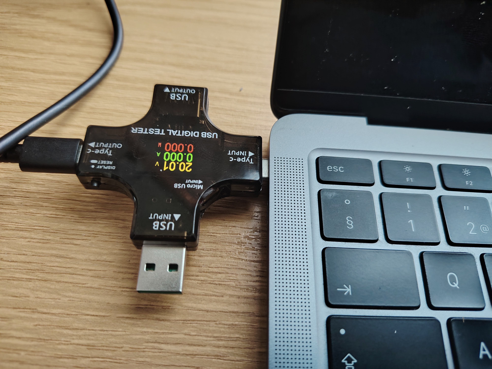

# Using a USB Digital Tester (J7-C) for MacBook Air Fault Diagnosis

This article explains how to measure USB charging data with a cheap AliExpress meter
(pictured below). The tester can be found by searching for *USB Tester Type-C PD Digital
Capacity Meter 8A Voltage Current Monitor Power Bank Charger Detector with QC3.0 Fast
Charging*. This model has a Bluetooth connection and works bidirectionally — the input
and output connectors can be used in reverse.

The meter costs approximately €14 including shipping. According to the included manual,
an Android app called E-Test is available on Google Play, but it targets very old Android
versions. The device is of course useful for measuring cable and charger condition without
any app at all. The display has several modes, including trend graphs.

---

Note that Xiaomi Turbo Charge, for example, is not based on the PD charging protocol.
Xiaomi often uses a USB-A → USB-C cable (red interior) for Turbo Charge, which has a
special eMarker / extra pin for PD communication (not standard USB-C → USB-C). If you
want to use the Python script below with non-standard charging, inspect the raw hex
values and adapt them to your measurement. The meter's VBUS readings will otherwise
be incorrect.

Example: if the meter transmits **ff5501030002100000be0001d3000000fb00560056001f000010053c0c80000003200029**

Breaking it down by offset (0–35):

- **0–1**: ff 55 → header (fixed)
- **2**: 01 → message type (report)
- **3**: 03 → device/subtype (USB meter)
- **4–6**: 00 02 10 → voltage 0x000210 = 528 → 5.28 V
- **7–9**: 00 00 be → current 0x0000be = 190 → 1.90 A
- **10–12**: 00 01 d3 → mAh 0x0001d3 = 467 mAh
- **13–15**: 00 00 00 → Wh 0x000000 = 0.00 Wh
- **16**: fb → unknown (possibly flags or mode)
- **17–18**: 00 56 → D+ 0x0056 = 86 → 0.86 V
- **19–20**: 00 56 → D- 0x0056 = 86 → 0.86 V
- **21–22**: 00 1f → temperature 0x001f = 31 °C
- **23–25**: 00 00 10 → unknown (possibly time / counter)
- **26–28**: 05 3c 0c → unknown (possibly impedance/resistance or runtime fields)
- **29–31**: 80 00 00 → unknown (possibly group / preset)
- **32–34**: 03 20 00 → unknown (possibly additional status)
- **35**: 29 → **checksum** (typically XOR or sum of all preceding bytes)

### What can the remaining bytes reveal?

The most common additional values identified by various reverse engineering projects
(atorch-console, J7-C loggers, sigrok, Arduino forums, etc.):

- **D+ / D− voltages** (offset ~17–20): USB data pins, important for detecting fast-charge
  protocols (QC, PD, Apple 2.4A).
- **Temperature** (offset ~21–22): Internal temperature (NTC sensor in the tester).
- **Resistance / Load Impedance** (often offset ~26–28 or 29–31): Load resistance (mΩ or Ω).
- **Charging time / Runtime** (typically 3–4 bytes somewhere): How long power has been
  applied (in seconds or BCD format).
- **Group number / preset**: Which "memory slot" the data is stored in on the tester.
- **Checksum** (last byte): Usually XOR of all preceding bytes, or a simple sum mod 256.

---

## USB-C PD

USB-C **Power Delivery (PD)** negotiation — also known as a **USB PD handshake** or
**power contract negotiation** — is the process by which USB-C devices (e.g. a charger
and a phone or MacBook) agree on the voltage, current, and power level for safe and
efficient energy transfer. It takes place over the **Configuration Channel** lines
(CC1 and CC2), two of the four additional pins in a USB-C connector. These are used
both to determine device roles and for digital communication.

### Step by Step — How PD Negotiation Works in Practice

**1. Connection and initial role detection**

When a cable is connected, the devices measure voltages on the CC lines (pull-up/down
resistors). This determines:

- Which is the **Source** (charger, supplying power) and which is the **Sink** (device,
  consuming power).
- Cable orientation (USB-C is reversible, so CC1/CC2 swap accordingly).

Initially, power is always supplied at **5 V** (typically 0.9–3 A) — this is the
USB-C default "legacy" level so that older devices work without PD. If either side
has no PD capability → the connection stays at 5 V / max 15 W with no negotiation.

**2. Source Capabilities message (charger announces what it supports)**

The **Source** (charger) sends a **Source_Capabilities** message (usually immediately
once the connection is confirmed). The message contains a list of **Power Data Objects**
(PDOs) — the available voltage/current combinations.

Example from a typical charger:

- PDO1: 5 V @ 3 A (15 W) — mandatory for all PD chargers
- PDO2: 9 V @ 3 A (27 W)
- PDO3: 15 V @ 3 A (45 W)
- PDO4: 20 V @ 5 A (100 W)
- PPS (Programmable Power Supply) ranges, e.g. 3.3–21 V @ 5 A (very fine-grained control)

The message is sent as a **BMC-encoded** (Biphase Mark Coding) signal on the CC line
(~300 kbit/s).

**3. Sink Request message (device requests what it needs)**

The **Sink** (e.g. MacBook or phone) reads the available PDOs and selects the most
suitable one (typically maximum power within its own limits).

Examples:

- MacBook Air requests 20 V / 3 A (60 W) if the charger supports it.
- A phone requests 9 V / 3 A (27 W) if supported.

The device sends a **Request** message containing a **Request Data Object (RDO)**:
the desired PDO index and current amount.

**4. Source Accept / Reject + PS_Ready**

The charger responds with:

- **Accept** (if ok) → then **PS_Ready** (Power Supply Ready) — indicates the voltage
  has now been switched to the requested level.
- **Reject** (if unable, e.g. overload or cable does not support it) → stays at the
  previous contract (usually 5 V).

Once PS_Ready arrives → power delivery changes to the requested voltage/current
(e.g. 5 V → 20 V within a few tens of milliseconds).

**5. Power contract is active**

Power is now transferred as agreed. The device can later request a change (e.g. if the
battery gets hot → lower power). If the connection is lost or an error occurs → revert
to default 5 V (Hard Reset / Cable Reset).

### What the Tester Sees at Each Stage

Always 5 V initially (before negotiation). D+ / D− pins may be involved in some older
fast-charge protocols (QC, Apple 2.4A), but **PD uses only the CC lines** — D+/D− may
be 0–0.9 V (data off) or higher if Apple/BC 1.2 support is in use. If negotiation fails
→ stays at 5 V even if the charger supports 100 W → current remains low (e.g. 0.5–1.5 A).

### Fault Diagnosis Summary

If a MacBook Air charges slowly:

- Check current (A): If below 2–3 A despite a 60–100 W charger → negotiation failed
  (wrong cable, dirty port, faulty charger, or cable does not properly support PD).
- Check voltage (V): If stuck at 5 V → no PD contract.
- Power (W) shows the overall picture, but the root cause is usually found in the
  V + A combination.

---

## License

MIT License

Copyright (c) 2025 Jari Hiltunen (Codeberg: [hiltsu](https://codeberg.org/hiltsu))

Permission is hereby granted, free of charge, to any person obtaining a copy
of this software and associated documentation files (the "Software"), to deal
in the Software without restriction, including without limitation the rights
to use, copy, modify, merge, publish, distribute, sublicense, and/or sell
copies of the Software, and to permit persons to whom the Software is
furnished to do so, subject to the following conditions:

The above copyright notice and this permission notice shall be included in all
copies or substantial portions of the Software.

THE SOFTWARE IS PROVIDED "AS IS", WITHOUT WARRANTY OF ANY KIND, EXPRESS OR
IMPLIED, INCLUDING BUT NOT LIMITED TO THE WARRANTIES OF MERCHANTABILITY,
FITNESS FOR A PARTICULAR PURPOSE AND NONINFRINGEMENT. IN NO EVENT SHALL THE
AUTHORS OR COPYRIGHT HOLDERS BE LIABLE FOR ANY CLAIM, DAMAGES OR OTHER
LIABILITY, WHETHER IN AN ACTION OF CONTRACT, TORT OR OTHERWISE, ARISING FROM,
OUT OF OR IN CONNECTION WITH THE SOFTWARE OR THE USE OR OTHER DEALINGS IN THE
SOFTWARE.
